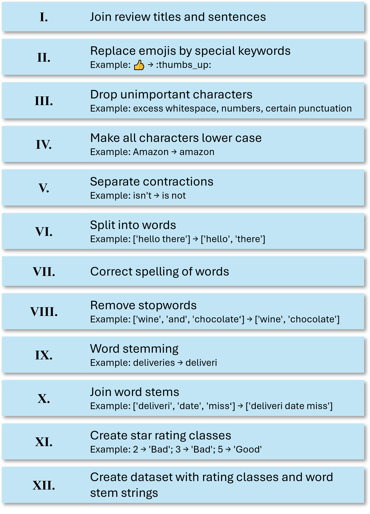
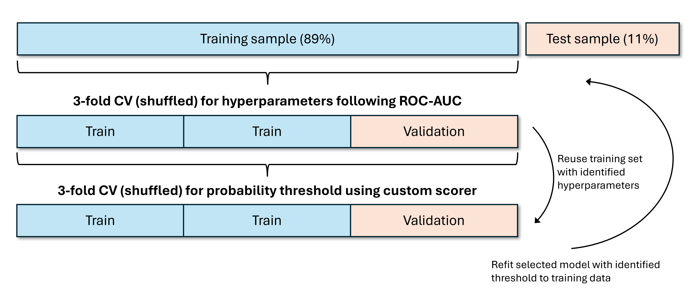

# 1 Executive summary

**Note:** this project is currently still a work in progress and will be updated regularly.

1. The scores are **strongly imbalanced**, where the vast **majority** of the reviews gives a rating of **one star**.

2. The **naive predictor** of simply labelling all reviews as `Bad` produces a **recall of 1.0** on the `Bad` class and **accuracy of 0.89** on the test set. This comes at the cost of poor performance on the `Good` class. This predictor implies that, in a real-world scenario, all incoming messages would have to be inspected manually.

3. **First impressions** of strongly tuned **logistic regression** predictors and **random forest** predictors show that test set accuracy can be improved to 0.94 to 0.95 with ease. The preferred solution so far is the tuned logistic regression predictor under TF-IDF-transformed word frequencies, which achieves test accuracy of 0.95 and a **`Bad` class recall** of **0.99**. The achieved **`Good` class recall** is **0.63**. Hence, we have **37% false-negatives** on the **`Good` class** and **1% false-negatives** on the **`Bad` class**. Given the global distribution of 89% `Bad` and 11% `Good` reviews, we can reduce the amount of overall messages to check manually by approx. 7.8% at the cost of ignoring 1% of the `Bad` messages, which is a very conservative trade-off. Further analysis on the actual costs related to this needs to be carried out elsewhere. 

# 2 Data

The anonymized dataset `amazon_com_reviews_trustpilot_20261026_anon.feather` in the GitHub repository [dschulz13/dataset-amazon_trustpilot_reviews](https://github.com/dschulz13/dataset-amazon_trustpilot_reviews.git) is considered. It contains all **32,632 English Trustpilot reviews** for **Amazon.com** published between August 27, 2007, and October 26, 2026. The data was originally scraped directly from the [Trustpilot webpage of Amazon.com](https://de.trustpilot.com/review/www.amazon.com?languages=en) using **Python's Selenium** extension.

For the sake of this project, only the available **reviews published since January 01, 2025** are used. This approximately gives a **cross-sectional overview of recent customer feedback**. Filtered this way, **9,688 reviews** remain for the analysis.

<details><summary>Show Python code</summary>

With the following code chunk, the dataset is read into Python and filtered, so that only reviews published on January 01, 2025, or later are kept. Initially, we also optimize memory usage by adjusting selected column data types.

```{python}
#| echo: True

import matplotlib.pyplot as plt
import matplotlib.ticker as ticker
import pandas as pd
import numpy as np

# URL to the data on GitHub
url = 'https://github.com/dschulz13/dataset-amazon_trustpilot_reviews/raw/refs/heads/main/amazon_com_reviews_trustpilot_20261026_anon.feather'

# Read in the data
data_filt = pd.read_feather(url)

# Function to reduce memory usage of data frame
def reduce_df_size(df, verbose = True):
    numerics = ['int8', 'int16', 'int32', 'int64', 'float16', 'float32',
'float64']
    if verbose:
        old_mem = df.memory_usage().sum() / 1024**2

    for col in df.columns:
        col_type = df[col].dtypes
        if col_type in numerics:
            c_min = df[col].min()
            c_max = df[col].max()
            if str(col_type)[:3] == 'int':
                if c_min >= np.iinfo(np.int8).min and c_max <= np.iinfo(np.int8).max:
                    df[col] = df[col].astype(np.int8)
                elif c_min >= np.iinfo(np.int16).min and c_max <= np.iinfo(np.int16).max:
                    df[col] = df[col].astype(np.int16)
                elif c_min >= np.iinfo(np.int32).min and c_max <= np.iinfo(np.int32).max:
                    df[col] = df[col].astype(np.int32)
                else:
                    df[col] = df[col].astype(np.int64)
            else:
                if c_min >= np.finfo(np.float16).min and c_max <= np.finfo(np.float16).max:
                    df[col] = df[col].astype(np.float16)
                elif c_min >= np.finfo(np.float32).min and c_max <= np.finfo(np.float32).max:
                    df[col] = df[col].astype(np.float32)
                else:
                    df[col] = df[col].astype(np.float64)
    df['User_Country'] = df['User_Country'].astype('category')
    df['Review_Date'] = pd.to_datetime(df['Review_Date'], format = '%Y-%m-%d %H:%M:%S', utc = True)
    df['Experience_Date'] = pd.to_datetime(df['Experience_Date'], format = '%Y-%m-%d', utc = True)

    if verbose:
        mem_new = (df.memory_usage().sum() / 1024**2).item()
        change_mem = abs(mem_new - old_mem)
        rel_mem = 100 * change_mem / old_mem
        print(f'Old memory usage: {old_mem:.2f}MB; new memory usage: {mem_new:.2f}MB; reduction of {change_mem:.2f}MB ({rel_mem:.2f}%)')
    return df

# Make apply reformatting of columns
data_filt['Review_Score'] = data_filt['Review_Score'].astype(int)
data_filt = reduce_df_size(data_filt)

# Keep observations since 2025-01-01 and reset index
data_filt = (
    data_filt[data_filt['Review_Date'] >= '2025-01-01 00:00:00']
        .reset_index(drop = True)
)

```

The following code chunk then provides general information about the filtered dataset and its variables.

```{python}
#| echo: True
#| eval: False
#| include: True
#| label: chunk-datainfo

# Show general information
print(data_filt.info())
print(data_filt[['Review_Date', 'Review_Score']].describe())
print(data_filt['Review_Sentences'][6])
```

A barplot of the star ratings in the filtered dataset can be produced as follows.

```{python}
#| echo: True
#| eval: False
#| include: True
#| label: chunk-scoreplot

star_counts = data_filt['Review_Score'].value_counts().sort_index(ascending = True)

def star_formatter(x, pos):
    n_star = int(round(x)) + 1
    return '★' * n_star 

fig, ax = plt.subplots(1, 1, figsize = (6, 3))
star_counts.plot(kind = 'bar', ax = ax, color = 'lightblue',
    edgecolor = 'black', alpha = 1, width = 0.9)
ax.set_xlabel('Star rating');
ax.set_ylabel('Number of ratings');
ax.set_title('Star rating distribution');
ax.yaxis.set_major_formatter(ticker.StrMethodFormatter('{x:,.0f}'));
ax.xaxis.set_major_formatter(ticker.FuncFormatter(star_formatter));
plt.xticks(rotation = 0, ha = 'center');
ax.grid(axis = 'y');
ax.set_axisbelow(True);
ax.set_ylim(0, 8300);
for i in range(0, 5):
    ax.text(x = i, y = star_counts.to_numpy()[i].item() + 300,
        s = f'{star_counts.to_numpy()[i].item():,}',
        ha = 'center', va = 'center')
```

</details>

```{python}
#| echo: False
#| eval: True
#| include: True
#| label: macro-info-run

# Show general information
print(data_filt.info())
print('\n')
print(data_filt[['Review_Date', 'Review_Score']].describe())
print('\n')
print(data_filt['Review_Sentences'][6])
```

From the data output, we can see that the dataset has the eight variables `User_ID`, `Review_Date`, `Experience_Date`, `User_Name`, `User_Country`, `Review_Score`, `Review_Title`, and `Review_Sentences`. Each row in the dataset is a unique review entry. `User_ID` is an `int` variable that uniquely identifies each author (and can be used to see, which person wrote multiple reviews). `Review_Date` and `Experience_Date` are both `datetime` variables. `Review_Score` is also an `int` column. `User_Name` and `Review_Title` are `str` columns containing the author's user name and the the document's review title, respectively. In contrast, `User_Country` is a `category` variable. `Review_Sentences` is an `object` column, where in each row it contains a list, whose entries are the different review sentences as strings.

Only `Review_Sentences` contains missing values sometimes, as review author's must specify a review title, but they are not obligated to write a review text. Therefore, in 137 instances no review text was written.

The star ratings are apparently strongly skewed / imbalanced. The mean rating is approx. 1.53, the median and even the 75th percentile of the observed rating distribution are simply 1.

```{python}
#| echo: False
#| eval: True
#| include: True
#| label: fig-macro-plot-run
#| fig-align: center
#| fig-cap: "The distribution of the star ratings in the filtered dataset."

star_counts = data_filt['Review_Score'].value_counts().sort_index(ascending = True)

def star_formatter(x, pos):
    n_star = int(round(x)) + 1
    return '★' * n_star 

fig, ax = plt.subplots(1, 1, figsize = (10, 3))
star_counts.plot(kind = 'bar', ax = ax, color = 'lightblue',
    edgecolor = 'black', alpha = 1, width = 0.9)
ax.set_xlabel('Star rating');
ax.set_ylabel('Number of ratings');
ax.set_title('Star rating distribution');
ax.yaxis.set_major_formatter(ticker.StrMethodFormatter('{x:,.0f}'));
ax.xaxis.set_major_formatter(ticker.FuncFormatter(star_formatter));
plt.xticks(rotation = 0, ha = 'center');
ax.grid(axis = 'y');
ax.set_axisbelow(True);
ax.set_ylim(0, 8500);
for i in range(0, 5):
    ax.text(x = i, y = star_counts.to_numpy()[i].item() + 300,
        s = f'{star_counts.to_numpy()[i].item():,}',
        ha = 'center', va = 'center')
```

@fig-macro-plot-run supports the previous statement on the strong imbalance in the data: 7,688 reviews are one-star reviews, where customers were as dissatisfied as possible. The remaining 2,000 reviews are spread across the two- to five-star reviews. Given that one-, two-, and five-star reviews appear most frequently (with a clear dominance of the one-star reviews), we conclude that strong emotional reactions to Amazon's services, either strongly positive or strongly negative, lead to a correspondingly higher chance of a review entry on Trustpilot. Since customers with intermediate-level (and also to some degree positive) satisfaction do not choose to write a review as often, the observed distribution can under no circumstances be understood as the real distribution of customer satisfaction.

# 3 Objective

A crucial task for any company is dealing with customer feedback. Commonly, companies offer direct channels to contact customer service and receive support, if they are dissatisfied with the companies service or product. Unfortunately, companies receive vast amounts of messages from customers on a daily basis, some of which do not contain urgent issues (or do not state any problems at all) the companies need to address immediately. However, each message requires manual inspection first to determine the implied urgency; a process which **costs a substantial amount of human labor**.

An algorithm inspecting and manually classifying incoming messages would filter out messages that do not state any severely negative customer experiences and thus **immensely recude the required human input** for this task.

Of course, training classification algorithms needs **pre-labelled training data**, which is not the case for incoming messages through common customer service channels. In case of Amazon.com, we train classification models on the **reviews from Trustpilot**, because they already include ratings, thus allowing for **simple labelling** of positive and negative customer experiences. Nonetheless, **transferability** to other channels needs to **inspected elsewhere**.

In the provided context, a natural basline approach is to simply predict every review as negative, thus enforcing the manual inspection of every message afterwards. Such an approach has both advantages and disadvantages: on one hand, no crucial negative review is missed, while on the other hand this approach raises many false alarms by labelling every non-negative message as negative. Treating four- and five-star reviews as `Good` and all other reviews as `Bad`, the share of bad reviews is approx. 89%. This native approach consequently leads to an **out-of-the-box overall classification accuracy of 89%** and a **recall of 100%** on the **`Bad` class** (for stratified test samples), but has **poor precision and recall** on the **`Good` class**.

The main objective of this project is hence the development of a classification algorithm to classify the Amazon.com reviews into good and bad reviews. Overall classification **accuracy** should be **improved**, while **ensuring a high precision and recall** on the **`Bad` class**, so that (a) the amount of **false alarms** is kept as **low** as possible, and (b) actual **bad reviews** are **identified reliably**.

# 4 Data cleaning

@fig-cleaning-steps demonstrates the cleaning pipeline for the pre-filtered review data.

{#fig-cleaning-steps height=60% width=60%}

The goal of the cleaning step is two-fold: firstly, we wish to categorize the star rating into two groups. Those groups will be labelled `Good` and `Bad`. A good review is a review with a four- or five-start rating. A bad review covers the remaining star ratings. Of course other class constructions are also possible and could be checked in further analyses. For the prupose of this project, we, however, assume that a rating of three stars or less indicates a notable dissatisfaction with the companies' services. Secondly, we clean the text data. The following diagram highlights the individual cleaning steps. We proceed by combining the review title and the review sentences of a given observation into a single string. As the main steps, we replace emojis by specific textual representations, remove numbers and some punctutation, but not all such as `?` or `!`, remove leading and trailing whitespace, turn all letters into lower case, separate word contractions, do spelling corrections, remove stop words, and ultimately implement word stemming. This form of cleaning can be done on the entire data at the same time, as each observation is treated individually and the described procedure thus does not produce data leakage.

<details><summary>Show Python code</summary>

```{python}
#| echo: True
#| eval: False
#| include: True

# Standard libraries
import re
import numpy as np
import pandas as pd

# Special libraries
import contractions
from autocorrect import Speller
import nltk
from nltk.corpus import stopwords
from nltk.tokenize import word_tokenize
from nltk.stem import SnowballStemmer
import emoji
import gc
from collections import Counter

# Setting up spell checks and word tokenization
nltk.download('punkt')
nltk.download('punkt_tab')
nltk.download('stopwords')
stop_words = set(stopwords.words('english'))
spell = Speller(lang = 'en')
```

The following code chunk provides the main cleaning function for the reviews.

```{python}
#| echo: True
#| eval: False
#| include: True

def clean_text(dataset, spell, stop_words):

    # Combine sentences into one text (and also add the review title at the beginning)
    reviews = dataset['Review_Sentences']
    l = len(reviews)
    review_adj = [''] * l
    for i in range(0, l):
        try:
            review_adj[i] = dataset['Review_Title'][i] + ' ' + ' '.join(dataset['Review_Sentences'][i])
        except TypeError:
            review_adj[i] = dataset['Review_Title'][i]

    dataset['Review_Sentences'] = review_adj
    del review_adj
    gc.collect()

    # Replace emojis by text replacement
    dataset['Review_Sentences'] = [emoji.demojize(review) for review in dataset['Review_Sentences']]
    # Replace everything except letters, numbers, whitespace, !, ?, and ' with a whitespace
    dataset['Review_Sentences'] = dataset['Review_Sentences'].str.replace(r'[^\w\s\'?!]', ' ', regex = True)
    # Replace all numbers and multiple whitespaces in a row by a single whitespace
    dataset['Review_Sentences'] = dataset['Review_Sentences'].str.replace(r'[\s0-9]+', ' ', regex = True)
    # Remove leading and trailing whitespace
    dataset['Review_Sentences'] = dataset['Review_Sentences'].str.strip()
    # Make everything lower case
    dataset['Review_Sentences'] = dataset['Review_Sentences'].str.lower()

    # Create a subobject of the review texts
    reviews = dataset['Review_Sentences']
    # Split English contractions into two words, for example "isn't" into "is not"
    reviews = [contractions.fix(review) for review in reviews]
    # Now replace all remaining ' by an empty string
    reviews = [re.sub(r'\'+', '', review) for review in reviews]
    # Break review texts into individual words
    reviews = [word_tokenize(review) for review in reviews]
    # Correct spelling
    reviews = [[spell(word) for word in review] for review in reviews]
    # Remove stop words like "and"
    reviews = [[word for word in word_list if word not in stop_words] for word_list in reviews]
    # Stemming
    snowball = SnowballStemmer(language = 'english')
    reviews = [[snowball.stem(w) for w in review] for review in reviews]

    l = len(reviews)
    review_adj = [''] * l
    for i in range(0, l):
        review_adj[i] = ' '.join(reviews[i])

    dataset['Review_Sentences'] = review_adj
    del(reviews, review_adj)
    gc.collect()

    dataset['Review_Sentences'] = dataset['Review_Sentences'].str.strip()
    dataset['Rating_Class'] = 'Bad'
    dataset.loc[dataset['Review_Score'] >= 4, 'Rating_Class'] = 'Good'
    dataset['Rating_Class'] = dataset['Rating_Class'].astype('category')

    dataset = dataset.drop(['User_ID', 'Review_Date', 'Experience_Date', 'User_Name', 'User_Country', 'Review_Score', 'Review_Title'], axis = 1)
    gc.collect()

    return dataset
```

After the illustrated setup, the actual data treatment can be summarized within the following few lines of code. The result is a cleaned dataset `amazon_reviews_cleaned.feather` that can be used for the actual analysis.

```{python}
#| echo: True
#| include: True
#| eval: False

# Run cleaning steps on the data
data_filt = clean_text(data_filt, spell, stop_words)

# Review texts are now fully cleaned and prepared for further analysis
data_filt.to_feather(f'amazon_reviews_cleaned.feather')

# Delete data from memory
del data_filt
gc.collect()
```

</details>

# 5 Design


## 5.1 Train-test split

The data is split into a training set and a test set before any further preprocessing of the cleaned texts. To ensure that the test set contains at least 1,000 observations, we consider a **test share** of **11%**, resulting in a **test sample size** of **1,066**. For simplicity, we only consider such a fixed split; more elaborate but also time- and memory-consuming approaches use nested cross-validation ideas with multiple training-test splits. For the purpose of this project, the size of the random test sample is, however, large enough to allow for a generalization of the findings. The split here is stratified, ensuring that both the training and the test sample reflect the 11% and 89% shares of `Good` and `Bad` reviews in the total dataset.

<details><summary>Show Python code</summary>

```{python}
from sklearn.model_selection import train_test_split
import pandas as pd
import gc

data_all = pd.read_feather(f'amazon_reviews_cleaned.feather')

X_train, X_test, y_train, y_test = train_test_split(
    data_all.Review_Sentences.tolist(),
    data_all.Rating_Class.tolist(),
    test_size = 0.11,
    random_state = 1,
    stratify = data_all.Rating_Class.tolist()
)

del data_all
gc.collect()
```

</details>

## 5.2 Word cloud

<details><summary>Show Python code</summary>

```{python}
#| echo: True
#| eval: False

from wordcloud import WordCloud
import matplotlib.pyplot as plt
import re

all_text = ' '.join(X_train)

x, y = np.ogrid[:1000, :1000]
mask = (x - 500) ** 2 + (y - 500) ** 2 > 400 ** 2
mask = 255 * mask.astype(int)

wcloud = (WordCloud(
    background_color = "white",
    collocations = False,
    random_state = 2,
    colormap = "coolwarm",
    mask = mask)
        .generate(all_text)
)
plt.imshow(wcloud, interpolation = "bilinear")
plt.axis("off")
plt.show()
```

</details>

```{python}
#| echo: False
#| eval: True
#| label: fig-wordcloud
#| fig-cap: 'A word cloud of the 200 most frequent training data word stems.'
#| fig-align: 'center'

from wordcloud import WordCloud
import matplotlib.pyplot as plt
import re
import numpy as np

all_text = ' '.join(X_train)

x, y = np.ogrid[:1000, :1000]
mask = (x - 500) ** 2 + (y - 500) ** 2 > 400 ** 2
mask = 255 * mask.astype(int)

wcloud = (WordCloud(
    background_color = "white",
    collocations = False,
    random_state = 2,
    colormap = "coolwarm",
    mask = mask)
        .generate(all_text)
)
plt.imshow(wcloud, interpolation = "bilinear")
plt.axis("off")
plt.show()
```

@fig-wordcloud represents a word cloud of the 200 most frequent word stems in the training data. It provides an overview of important terms to look out for in the data. Obviously, `amazon` appears most often, followed by stems such as `custom` (customer/s), `deliveri` (delivery/deliveries) and `order`. Frequent terms also include `refund`, `return`, `time`, `day`, `servic`, hinting the importance of short-term deliveries and of return / refund policies.

## 5.3 Transformation of word frequencies

In many instances such as regularized logistic regression, it is common to transform the input features, so that they are "on the same scale" and so that no feature dominates the regularization penalty simply due to its scaling. In the given context, we are dealing with word frequencies, which are, in some sense, already on the same scale. However, values of the features are heavily influenced by other factors such as text length. To not destroy the sparsity of the feature matrix, it is hence quite common to implement a TF-IDF transformation of word frequencies, which keeps the zero entries and transforms the non-zero entries to account for rarity of words across all texts and individual text length. This way, rare but meaningful words can gain more weight. In the following, all models will be run both with standard frequencies and transformed frequencies to investigate, which strategy performs best.

## 5.4 Score function

In this specific business context, defining the `Bad` class as the positive class, false-negatives and false-positives are both costly in their own rights. A false-positive creates extra manual labor, while a false-negative means ignoring a message containing negative feedback, which could have negative effects on the company's reputation. Overall, a false-negative should be seen as far more costly than a false-positive.

Therefore, the selected class predictor should aim to minimize a cost function of the form
$$C_{\text{T}} = -(C_{\text{FN}}\times N_{\text{FN}}+C_{\text{FP}}\times N_{\text{FP}}),$$
where $N_{\text{FN}}$ and $N_{\text{FP}}$ are numbers of false-negatively and false-positively classified documents, respectively, and where $C_{\text{FN}}\geq 0$ and $C_{\text{FP}}\geq 0$ are unit-costs associated with corresponding misclassifications. $C_{\text{T}}$ is then the total cost as a negative number that needs to be maximized. In the given setup, we consider $C_{\text{FN}}=4$ and $C_{\text{FP}}=1$, so that a false-negative is four times as costly as a false-positive. Simultaneously, to avoid that classifiers simply select the naive predictor, we implemented the contraint that a `Bad` class precision $\leq 0.95$ is penalized strongly. Since the naive predictor has `Bad` class precision 0.89, this scenario is avoided.

## 5.5 Estimation framework

@fig-cv-steps shows the training and evaluation framework for most of the classifiers.

{#fig-cv-steps}

Following the training-test split of 89%-11%, we use 3-fold CV on the training set to identify optimal hyperparameters using the ROC-AUC criterion. Since ROC-AUC is a criterion independent from probability thresholds, it can be considered to select an overall well-rounded classifier. In this step, we consider randomized CV in almost all cases with selection of 30 instances from the entire parameter grid. Only in cases with small hyperparameter grids to begin with, we will implement the entire grid search. In a separate step, we use 3-fold CV using our own scoring function on the training data using the previously identified hyperparameters to ifentify the optimal probability threshold for classification. Given the hyperparameters and the threshold, the selected model is refitted to the entire training data and evaluated on the test data.

This two-step procedure benefits from a relatively small computational burden that will identify a reliable class predictor in a small amount of time. A mathematically more elaborate approach would involve nested CV, where for each setting of hyperparameters in the  outer CV loop, an optimal threshold would be identified on an inner CV loop. Since such an idea is time consuming for larger hyperparameter grids and complex models, we ignore this idea in this project.

# 6 Analysis

Throughout the analysis, we derive numerical features from 1-grams of the cleaned review texts, i.e. variables taken from individual words. This keeps the feature engineering simple enough, avoids high dimensionality in the feature space and reduces computation times. More in-depth approaches not considered here may also include 2-grams or 3-grams, and thus variables derived from chains of multiple words.

 

## 6.1 Baseline prediction

As indicated earlier, the baseline approach of simply always predicting the `Bad` class results in a high overall classification accuracy of 89% (all `Bad` reviews are classified correctly, whereas all `Good` reviews are classified incorrectly). Hence, for the `Bad` class, we achieve with minimum effort high scores (precision: 0.89; recall: 1.00), while the method produces the worst possible scores for the `Good` class (precision: 0.00; recall: 0.00). Note that for the precision to be 0.00, we defined a division by zero to be equal to zero in the reporting function.

<details><summary>Show Python code</summary>

```{python}
from sklearn.metrics import classification_report, make_scorer, confusion_matrix, precision_score
import numpy as np

def neg_cost_fun(y_true, y_pred, c_fn = 4, c_fp = 1):
    prec = precision_score(y_true, y_pred, pos_label = 'Bad')
    if prec <= 0.95:
        return -1000000.0
    conf = confusion_matrix(y_true, y_pred)
    return -(c_fp * conf[1, 0].item() + c_fn * conf[0, 1].item())

scorer = make_scorer(neg_cost_fun)

pred_baseline = np.array(['Bad'] * len(y_test))
```

```{python}
#| echo: True
#| eval: False

print(classification_report(y_test, pred_baseline,
        zero_division = 0.0))
```

</details>

```{python}
#| echo: False
#| eval: True

print(classification_report(y_test, pred_baseline,
        zero_division = 0.0))
```

## 6.2 Logistic regression

### 6.2.1 No standardization of word frequencies

As a first, more elaborate approach, a fine-tuned regularized logistic regression is implemented. In the outer cross-validation, we tune the penalty term (`C`), the class weights (`class_weight`), and the form of regularization (`l1_ratio`), while the inner cross-validation handles the probability threshold selection. Ultimately, `C = 0.1`, `class_weight = {'Bad': 1.0, 'Good': 4.0}`, and `l1_ratio = 0.0` are selected, corresponding to a strongly regularized ridge logistic regression, where incorrect classification of the `Good` class costs four times more than an incorrect classification of the `Bad` class. With these hyperparameters, the model is then refitted to the entire training sample, while re-selecting the probability threshold with cross-validation to be approx. 0.7677. 

<details><summary>Show Python code</summary>

```{python}
#| echo: False
#| eval: True
#| include: False

from sklearn.feature_extraction.text import CountVectorizer
from sklearn.linear_model import LogisticRegression
from sklearn.model_selection import RandomizedSearchCV, TunedThresholdClassifierCV, StratifiedKFold
from imblearn.pipeline import Pipeline
import pickle

### General settings for CountVectorizer
tokenizer = str.split    # create words by splitting cleaned texts by whitespace
preprocessor = None      # no additional preprocessing
token_pattern = None     # no further token identification
lowercase = False        # no further lower case transformation need
min_df = 10              # consider only words appearing in at least ten documents
max_df = 1000000000      # (practically) no limit for number of documents with a specific word

### Base settings for logistic regression
solver = 'saga'
random_state = 1
max_iter = 5000
```

```{python}
#| warning: False
#| eval: False

from sklearn.feature_extraction.text import CountVectorizer
from sklearn.linear_model import LogisticRegression
from sklearn.model_selection import RandomizedSearchCV, GridSearchCV, TunedThresholdClassifierCV, StratifiedKFold
from imblearn.pipeline import Pipeline
import pickle

### General settings for CountVectorizer
tokenizer = str.split    # create words by splitting cleaned texts by whitespace
preprocessor = None      # no additional preprocessing
token_pattern = None     # no further token identification
lowercase = False        # no further lower case transformation need
min_df = 10              # consider only words appearing in at least ten documents
max_df = 1000000000      # (practically) no limit for number of documents with a specific word

### Base settings for logistic regression
solver = 'saga'
random_state = 1
max_iter = 5000

model1 = Pipeline([
    # Create word frequency variables for each review from the training set
    ('dtm', CountVectorizer(
        tokenizer = tokenizer,    
        preprocessor = preprocessor,      
        token_pattern = token_pattern,     
        lowercase = lowercase,        
        min_df = min_df,               
        max_df = max_df        
    )),
    # Model definition
    ('model', LogisticRegression(
        solver = solver,
        random_state = random_state,
        max_iter = max_iter
    ))
])

model1_params = {
    'model__C': [0.01, 0.1, 1, 10, 100],
    'model__class_weight': [None, 'balanced', {'Bad': 2.0, 'Good': 1.0}, {'Bad': 1.0, 'Good': 2.0}, {'Bad': 1.0, 'Good': 4.0}],
    'model__l1_ratio': [0.0, 0.25, 0.5, 0.75 , 1.0]
}

model1_step1 = RandomizedSearchCV(
    model1,
    model1_params,
    scoring = 'roc_auc',
    cv = StratifiedKFold(3, random_state = 1, shuffle = True),
    n_jobs = -1,
    random_state = 1,
    n_iter = 30
)

model1_step1.fit(X_train, y_train)
model1_tuned = TunedThresholdClassifierCV(
    estimator = model1_step1.best_estimator_,
    scoring = scorer,
    cv = StratifiedKFold(3, random_state = 1, shuffle = True),
    thresholds = 100,
    refit = True,
    n_jobs = -1
)
model1_tuned.fit(X_train, y_train)

pickle.dump(model1_tuned, open('logit_model_not_stand.bin', 'wb'))

pred_model1 = model1_tuned.predict(X_test)
report_model1 = classification_report(y_test, pred_model1)
print(report_model1)
print(f'Custom cost: {neg_cost_fun(y_test, pred_model1)}')
```

</details>

The test sample evaluation is summarized in the following Python report. In comparison to the naive approach, the overall accuracy could be increased from 0.89 to 0.92. The average (unweighted) recall increased from 0.5 to 0.89. Most indicators increase, with the exception of the `Bad` class recall, which decreased from 1.00 to 0.93: the improvement in the other measures comes at the cost of not being able to identify all the `Bad` labels.

```{python}
#| echo: False
#| eval: True
#| include: True

import pickle
model1_tuned = pickle.load(open('logit_model_not_stand.bin', 'rb'))
pred_model1 = model1_tuned.predict(X_test)
report_model1 = classification_report(y_test, pred_model1)
print(report_model1)
print(f'Custom cost: {neg_cost_fun(y_test, pred_model1)}')
```

### 6.2.2 Standardization of word frequencies

<details><summary>Show Python code</summary>

```{python}
#| echo: False
#| eval: True
#| include: False

from sklearn.feature_extraction.text import TfidfTransformer
```

```{python}
#| echo: True
#| eval: False
#| include: True

from sklearn.feature_extraction.text import TfidfTransformer

model2 = Pipeline([
    ('dtm', CountVectorizer(
        tokenizer = tokenizer,    
        preprocessor = preprocessor,      
        token_pattern = token_pattern,     
        lowercase = lowercase,        
        min_df = min_df,               
        max_df = max_df        
    )),
    ('standard', TfidfTransformer(
        use_idf = True,
        norm = "l2", 
        sublinear_tf = True
    )),
    ('model', LogisticRegression(
        solver = solver,
        random_state = random_state,
        max_iter = max_iter
    ))
])

model2_params = {
    'model__C': [0.01, 0.1, 1, 10, 100],
    'model__class_weight': [None, 'balanced', {'Bad': 2.0, 'Good': 1.0}, {'Bad': 1.0, 'Good': 2.0}, {'Bad': 1.0, 'Good': 4.0}],
    'model__l1_ratio': [0.0, 0.25, 0.5, 0.75, 1.0]
}

model2_step1 = RandomizedSearchCV(
    model2,
    model2_params,
    scoring = 'roc_auc',
    cv = StratifiedKFold(3, random_state = 1, shuffle = True),
    n_jobs = -1,
    random_state = 1,
    n_iter = 30
)
model2_step1.fit(X_train, y_train)


model2_tuned = TunedThresholdClassifierCV(
    estimator = model2_step1.best_estimator_,
    scoring = scorer,
    cv = StratifiedKFold(3, random_state = 1, shuffle = True),
    thresholds = 100,
    refit = True,
    n_jobs = -1
)
model2_tuned.fit(X_train, y_train)

pickle.dump(model2_tuned, open('logit_model_stand.bin', 'wb'))

pred_model2 = model2_tuned.predict(X_test)
report_model2 = classification_report(y_test, pred_model2)
print(report_model2)
print(f'Custom cost: {neg_cost_fun(y_test, pred_model2)}')
```

</details>


```{python}
#| echo: False
#| eval: True
#| include: True

model2_tuned = pickle.load(open('logit_model_stand.bin', 'rb'))
pred_model2 = model2_tuned.predict(X_test)
report_model2 = classification_report(y_test, pred_model2)
print(report_model2)
print(f'Custom cost: {neg_cost_fun(y_test, pred_model2)}')
```

## 6.3 Naive Bayes

### 6.3.1 No standardization of word frequencies

```{python}
#| echo: False
#| eval: True
#| include: False

from sklearn.naive_bayes import GaussianNB
from sklearn.preprocessing import FunctionTransformer
from imblearn.over_sampling import RandomOverSampler
```

<details><summary>Show Python code</summary>

```{python}
#| echo: True
#| eval: False
#| include: True

from sklearn.naive_bayes import GaussianNB
from sklearn.preprocessing import FunctionTransformer
from imblearn.over_sampling import RandomOverSampler
from sklearn.model_selection import GridSearchCV

def fun_toarray(x):
    return x.toarray()

model3 = Pipeline([
    ('dtm', CountVectorizer(
        tokenizer = tokenizer,    
        preprocessor = preprocessor,      
        token_pattern = token_pattern,     
        lowercase = lowercase,        
        min_df = min_df,               
        max_df = max_df        
    )),
    ('oversampler', RandomOverSampler(random_state = 1)),
    ('to_dense', FunctionTransformer(fun_toarray, accept_sparse = True)),
    ('model', GaussianNB())
])

model3_params = {
    'oversampler__sampling_strategy': [0.12, 0.2, 0.4, 0.6, 0.8, 1.0]
}

model3_step1 = GridSearchCV(
    model3,
    model3_params,
    scoring = 'roc_auc',
    cv = StratifiedKFold(3, random_state = 1, shuffle = True),
    n_jobs = -1
)
model3_step1.fit(X_train, y_train)

model3_tuned = TunedThresholdClassifierCV(
    estimator = model3_step1.best_estimator_,
    refit = True,
    scoring = scorer,
    cv = StratifiedKFold(3, random_state = 1, shuffle = True),
    thresholds = 100,
    n_jobs = -1
)
model3_tuned.fit(X_train, y_train)

pickle.dump(model3_tuned, open('nbayes_model_not_stand.bin', 'wb'))

pred_model3 = model3_tuned.predict(X_test)
report_model3 = classification_report(y_test, pred_model3)
print(report_model3)
print(f'Custom cost: {neg_cost_fun(y_test, pred_model3)}')
```

</details>

```{python}
#| echo: False
#| eval: True
#| include: True

from sklearn.naive_bayes import GaussianNB
from sklearn.preprocessing import FunctionTransformer
from imblearn.over_sampling import RandomOverSampler

def fun_toarray(x):
    return x.toarray()

model3_tuned = pickle.load(open('nbayes_model_not_stand.bin', 'rb'))
pred_model3 = model3_tuned.predict(X_test)
report_model3 = classification_report(y_test, pred_model3)
print(report_model3)
print(f'Custom cost: {neg_cost_fun(y_test, pred_model3)}')
```

### 6.3.2 Standardization of word frequencies

<details><summary>Show Python code</summary>

```{python}
#| echo: True
#| eval: False
#| include: True

model4 = Pipeline([
    ('dtm', CountVectorizer(
        tokenizer = tokenizer,    
        preprocessor = preprocessor,      
        token_pattern = token_pattern,     
        lowercase = lowercase,        
        min_df = min_df,               
        max_df = max_df        
    )),
    ('standard', TfidfTransformer(
        use_idf = True,
        norm = "l2", 
        sublinear_tf = True
    )),
    ('oversampler', RandomOverSampler(random_state = 1)),    
    ('to_dense', FunctionTransformer(fun_toarray, accept_sparse = True)),
    ('model', GaussianNB())
])

model4_tuned_inner = TunedThresholdClassifierCV(
    estimator = model4,
    refit = True,
    scoring = scorer,
    cv = StratifiedKFold(3, random_state = 1, shuffle = True),
    thresholds = 20,
    n_jobs = 1
)

model4_params = {
    'oversampler__sampling_strategy': [0.12, 0.2, 0.4, 0.6, 0.8, 1.0]
}

model4_step1 = GridSearchCV(
    model4,
    model4_params,
    scoring = 'roc_auc',
    cv = StratifiedKFold(3, random_state = 1, shuffle = True),
    n_jobs = -1
)
model4_step1.fit(X_train, y_train)

model4_tuned = TunedThresholdClassifierCV(
    estimator = model4_step1.best_estimator_,
    refit = True,
    scoring = scorer,
    cv = StratifiedKFold(3, random_state = 1, shuffle = True),
    thresholds = 100,
    n_jobs = -1
)
model4_tuned.fit(X_train, y_train)

pickle.dump(model4_tuned, open('nbayes_model_stand.bin', 'wb'))

pred_model4 = model4_tuned.predict(X_test)
report_model4 = classification_report(y_test, pred_model4)
print(report_model4)
print(f'Custom cost: {neg_cost_fun(y_test, pred_model4)}')
```

</details>

```{python}
#| echo: False
#| eval: True
#| include: True

model4_tuned = pickle.load(open('nbayes_model_stand.bin', 'rb'))
pred_model4 = model4_tuned.predict(X_test)
report_model4 = classification_report(y_test, pred_model4)
print(report_model4)
print(f'Custom cost: {neg_cost_fun(y_test, pred_model4)}')
```

## 6.4 LDA

## 6.5 Random Forest

### 6.5.1 No standardization of word frequencies

<details><summary>Show Python code</summary>

```{python}
#| echo: True
#| eval: False

from sklearn.ensemble import RandomForestClassifier

rf_model = Pipeline([
    ('dtm', CountVectorizer(
        tokenizer = tokenizer,    
        preprocessor = preprocessor,      
        token_pattern = token_pattern,     
        lowercase = lowercase,        
        min_df = min_df,               
        max_df = max_df        
    )),
    ('model', RandomForestClassifier(criterion = 'entropy', random_state = 1))
])

rf_params = {
    'model__n_estimators': [100, 200],
    'model__max_depth': [40, 50, 60],
    'model__max_features': np.arange(0.2, 0.85, 0.05).tolist(),
    'model__class_weight': [None, 'balanced', {'Bad': 2.0, 'Good': 1.0}, {'Bad': 1.0, 'Good': 2.0}, {'Bad': 1.0, 'Good': 4.0}]
}

rf_model_step1 = RandomizedSearchCV(
    rf_model,
    rf_params,
    cv = StratifiedKFold(3, shuffle = True, random_state = 1),
    refit = True,
    scoring = 'roc_auc',
    n_jobs = -1,
    random_state = 1,
    n_iter = 30
)
rf_model_step1.fit(X_train, y_train)

rf_model_tuned = TunedThresholdClassifierCV(
    rf_model_step1.best_estimator_,
    scoring = scorer,
    thresholds = 100,
    cv = StratifiedKFold(3, random_state = 1, shuffle = True),
    refit = True,
    n_jobs = -1
)
rf_model_tuned.fit(X_train, y_train)

pickle.dump(rf_model_tuned, open('rf_model_not_stand.bin', 'wb'))

pred_model_rf = rf_model_tuned.predict(X_test)
report_model_rf = classification_report(y_test, pred_model_rf)
print(report_model_rf)
print(f'Custom cost: {neg_cost_fun(y_test, pred_model_rf)}')
```

</details>

```{python}
#| echo: False
#| eval: True

rf_model_tuned = pickle.load(open('rf_model_not_stand.bin', 'rb'))

pred_model_rf = rf_model_tuned.predict(X_test)
report_model_rf = classification_report(y_test, pred_model_rf)
print(report_model_rf)
print(f'Custom cost: {neg_cost_fun(y_test, pred_model_rf)}')
```

### 6.5.2 Standardization of word frequencies

<details><summary>Show Python code</summary>

```{python}
#| echo: True
#| eval: False

rf_model = Pipeline([
    ('dtm', CountVectorizer(
        tokenizer = tokenizer,    
        preprocessor = preprocessor,      
        token_pattern = token_pattern,     
        lowercase = lowercase,        
        min_df = min_df,               
        max_df = max_df        
    )),
    ('standard', TfidfTransformer(
        use_idf = True,
        norm = "l2", 
        sublinear_tf = True
    )),    
    ('model', RandomForestClassifier(criterion = 'entropy', random_state = 1))
])


rf_params = {
    'model__n_estimators': [100, 200],
    'model__max_depth': [30, 40, 50],
    'model__max_features': np.arange(0.2, 0.85, 0.05).tolist(),
    'model__class_weight': [None, 'balanced', {'Bad': 2.0, 'Good': 1.0}, {'Bad': 1.0, 'Good': 2.0}, {'Bad': 1.0, 'Good': 4.0}]
}

rf_model_step1 = RandomizedSearchCV(
    rf_model,
    rf_params,
    cv = StratifiedKFold(3, shuffle = True, random_state = 1),
    refit = True,
    scoring = 'roc_auc',
    n_jobs = -1,
    random_state = 1,
    n_iter = 30
)
rf_model_step1.fit(X_train, y_train)

rf_model_tuned = TunedThresholdClassifierCV(
    rf_model_step1.best_estimator_,
    scoring = scorer,
    thresholds = 100,
    cv = StratifiedKFold(3, random_state = 1, shuffle = True),
    refit = True,
    n_jobs = -1
)
rf_model_tuned.fit(X_train, y_train)

pickle.dump(rf_model_tuned, open('rf_model_stand.bin', 'wb'))

pred_model_rf = rf_model_tuned.predict(X_test)
report_model_rf = classification_report(y_test, pred_model_rf)
print(report_model_rf)
print(f'Custom cost: {neg_cost_fun(y_test, pred_model_rf)}')
```

</details>

```{python}
#| echo: False
#| eval: True
#| include: True

rf_model2_tuned = pickle.load(open('rf_model_stand.bin', 'rb'))
pred_model_rf2 = rf_model2_tuned.predict(X_test)
report_model_rf2 = classification_report(y_test, pred_model_rf2)
print(report_model_rf2)
print(f'Custom cost: {neg_cost_fun(y_test, pred_model_rf2)}')
```

## 6.8 Boosted tree methods

```{python}
from sklearn.ensemble import GradientBoostingClassifier

boost_model = Pipeline([
    ('dtm', CountVectorizer(
        tokenizer = tokenizer,    
        preprocessor = preprocessor,      
        token_pattern = token_pattern,     
        lowercase = lowercase,        
        min_df = min_df,               
        max_df = max_df        
    )),
    ('sampler', RandomOverSampler(random_state = 1)),
    ('model', GradientBoostingClassifier(loss = 'log_loss', random_state = 1))
])

boost_params = {
    'sampler__sampling_strategy': [0.2, 0.4, 0.6, 0.8, 1.0],
    'model__n_estimators': [100, 200],
    'model__max_depth': [20, 30, 40],
    'model__max_features': np.arange(0.2, 0.85, 0.05).tolist(),
    'model__learning_rate': [0.01, 0.1, 1]
}

boost_model_step1 = RandomizedSearchCV(
    boost_model,
    boost_params,
    cv = StratifiedKFold(3, shuffle = True, random_state = 1),
    refit = True,
    scoring = 'roc_auc',
    n_jobs = -1,
    random_state = 1,
    n_iter = 30
)
boost_model_step1.fit(X_train, y_train)

boost_model_tuned = TunedThresholdClassifierCV(
    boost_model_step1.best_estimator_,
    scoring = scorer,
    thresholds = 100,
    cv = StratifiedKFold(3, random_state = 1, shuffle = True),
    refit = True,
    n_jobs = -1
)
boost_model_tuned.fit(X_train, y_train)

pickle.dump(boost_model_tuned, open('boost_model_not_stand.bin', 'wb'))

pred_model_boost = boost_model_tuned.predict(X_test)
report_model_boost = classification_report(y_test, pred_model_boost)
print(report_model_boost)
print(f'Custom cost: {neg_cost_fun(y_test, pred_model_boost)}')

```


```{python}
#| echo: False
#| eval: True
#| include: True

del (rf_model_tuned, rf_model2_tuned)
gc.collect()

boost_model_tuned = pickle.load(open('boost_model_not_stand.bin', 'rb'))
pred_model_boost = boost_model_tuned.predict(X_test)
report_model_boost = classification_report(y_test, pred_model_boost)
print(report_model_boost)
print(f'Custom cost: {neg_cost_fun(y_test, pred_model_boost)}')
```